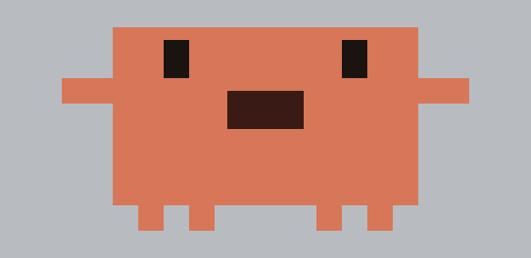
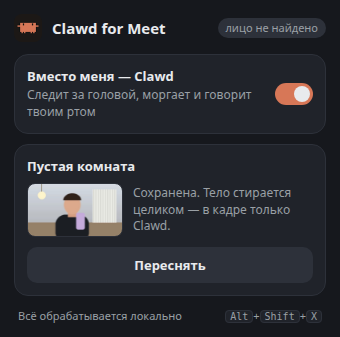

# Clawd for Meet

Chrome-расширение для Google Meet: вместо тебя в камере **Clawd**, маскот Claude Code. Он следит за головой и наклоняется вместе с ней, моргает, когда моргаешь ты, и открывает рот, когда ты говоришь.

 

## Установка

1. `git clone https://github.com/anton-cheg/thanos-for-meet -b clawd-mascot`
2. Открой `chrome://extensions`, включи **Режим разработчика**.
3. **Загрузить распакованное** → выбери папку репозитория.
4. Перезагрузи вкладку Google Meet и включи камеру. Clawd появится сразу.

## Как пользоваться

- Переключатель **«Вместо меня — Clawd»** в popup или `Alt+Shift+X` включает и выключает маскота.
- **Пустая комната** — необязательный шаг. Без снимка Clawd перекрывает голову и плечи, а вокруг остаётся живое видео. Если снять комнату без себя (`Снять комнату`, затем 3 секунды выйти из кадра), фон заменяется этим снимком, и тело пропадает целиком: в кадре остаётся только Clawd. `Alt+Shift+R` — то же самое с клавиатуры.

Хоткеи можно поменять в `chrome://extensions/shortcuts`.

## Как это работает

- `src/inject.js` выполняется в MAIN world страницы на `document_start` и оборачивает `navigator.mediaDevices.getUserMedia`. Видеотрек камеры прогоняется через `MediaStreamTrackProcessor` → `OffscreenCanvas` → `MediaStreamTrackGenerator`. Аудиотрек не меняется, к нему только подключается `AnalyserNode`, чтобы знать громкость голоса.
- Трекинг лица — MediaPipe Face Landmarker. Он работает в скрытом iframe со страницей самого расширения (`detector/`), так что CSP и Trusted Types страницы Meet его не касаются. Кадры уменьшаются до 256 px и уходят туда как `ImageBitmap` через `MessagePort`, примерно 20 раз в секунду. Обратно приходят рамка лица, линия глаз и blendshapes.
- Clawd рисуется по пиксельной сетке, снятой с логотипа Claude Code (`▐▛███▜▌` / `▝▜█████▛▘` / `▘▘ ▝▝`), с удлинённым телом. Ширина подбирается под плечи (≈3 ширины лица), наклон — по линии глаз. Позиция сглаживается между детекциями.
- Рот открывается по `max(jawOpen, громкость микрофона)`: быстро открывается и медленнее закрывается, поэтому речь выглядит как болтовня, а не мерцание. Глаза закрываются по `eyeBlinkLeft/Right`.
- Если лицо потерялось, Clawd ещё 1.5 секунды остаётся на последнем месте.
- Всё обрабатывается локально. Модель и wasm лежат в `vendor/`, по сети ничего не грузится.

Ограничения: нужен Chrome/Chromium с Insertable Streams. Трекинг съедает немного CPU/GPU. Снимок комнаты работает, только пока камера стоит на месте.

## Тесты

```bash
npm install
npx playwright install chromium
npm test                          # базовые проверки на синтетической камере
FACE_VIDEO=talking.mp4 npm test   # плюс трекинг лица и рот (нужен короткий ролик с говорящим лицом)
DEMO=1 ...                        # плюс test/out/demo.gif и popup.png
```

Тест загружает расширение в Chromium с фейковой камерой и подменяет страницу `meet.google.com` заглушкой, чтобы отработали настоящие content scripts и iframe детектора. Проверяется, что страница получает из `getUserMedia`:

- лицо находится, и Clawd стоит на нём;
- рот открывается и закрывается в такт речи;
- с выключенным маскотом камера идёт без изменений;
- после снимка комнаты фон вокруг Clawd неподвижен;
- остановка трека выключает камеру.

`FACE_VIDEO` берёт кусок ролика (`FACE_START`, `FACE_DURATION`), уменьшает его до пропорций вебки и гоняет туда-обратно.

## Лицензия

MIT. Сторонние файлы в `vendor/` — Apache-2.0 (см. `vendor/README.md`).
