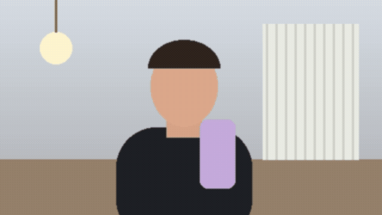

# Thanos for Meet

Chrome-расширение для Google Meet и веб-версии Discord (discord.com в браузере): снимаешь пустую комнату — и исчезаешь из кадра. Собеседники видят комнату без тебя. В **режиме Таноса** ты рассыпаешься в пыль, а при возвращении собираешься обратно.




## Установка

1. `git clone https://github.com/anton-cheg/thanos-for-meet`
2. Открой `chrome://extensions`, включи **Режим разработчика**.
3. **Загрузить распакованное** → выбери папку репозитория.
4. Перезагрузи вкладку Google Meet или Discord.

## Как пользоваться

1. Зайди в звонок с включённой камерой.
2. Нажми **Снять комнату** и в течение 3 секунд выйди из кадра. Снимок сохранится, переснимать его каждый звонок не нужно, пока камера стоит на месте.
3. **Исчезнуть** — в кадре остаётся пустая комната. **Вернуться** — ты снова в кадре.
4. Включи **По щелчку пальцами** — и исчезай щелчком, как Танос. Ещё один щелчок — возвращаешься. Работает и с выключенным в звонке микрофоном, но микрофон в звонке должен быть подключён. Если срабатывает от хлопков или клавиатуры — убавь чувствительность.

| Хоткей | Действие |
| --- | --- |
| `Alt+Shift+X` | исчезнуть / вернуться |
| `Alt+Shift+R` | снять комнату (с отсчётом 3 с) |

Хоткеи можно поменять в `chrome://extensions/shortcuts`.

## Как это работает

- `src/inject.js` выполняется в MAIN world страницы на `document_start` и оборачивает `navigator.mediaDevices.getUserMedia`. Каждый видеотрек камеры прогоняется через `MediaStreamTrackProcessor` → `OffscreenCanvas` → `MediaStreamTrackGenerator`, и сайт (Meet или Discord) получает уже обработанный трек. Пока ты в кадре, кадры отдаются как есть, без перерисовки.
- Снимок комнаты усредняется по 8 кадрам, чтобы убрать шум сенсора.
- **Режим Таноса** обходится без нейросетей. Маска человека считается вычитанием фона: пиксели, которые отличаются от снятой пустой комнаты. Внутри маски берутся частицы с цветами кадра. Каждой клетке назначается момент «распада» (волна слева направо плюс value noise). Распавшиеся клетки заменяются комнатой с мягкой границей, а частицы улетают вправо-вверх и гаснут. Возвращение — та же анимация, проигранная назад.
- **Щелчок** ловится без нейросетей: расширение слушает копию микрофонного трека страницы (`MediaStreamTrackProcessor`, блоки по 5 мс, фильтр выше 2 кГц). Щелчок — это резкий скачок высокочастотной энергии над уровнем шума, который затухает быстрее 100 мс. Речь отсекается по доле высоких частот, взрывные «т»/«к» — по громкой гласной после них, шипение — по длительности. Хлопок, скорее всего, тоже сработает.
- Всё обрабатывается локально, никуда ничего не отправляется. Снимок комнаты хранится в `chrome.storage.local`.

Ограничения: камера и освещение должны оставаться такими же, как при снимке. Если камеру сдвинули, комнату нужно переснять. Нужен Chrome/Chromium с Insertable Streams (`MediaStreamTrackProcessor`).

## Тесты

```bash
npm install
npx playwright install chromium
npm test          # e2e: фейковая камера, настоящие content scripts, 11 проверок
DEMO=1 npm test   # плюс test/out/demo.gif и popup.png
```

Тест генерирует фейковую камеру (`test/make_fake_camera.py`: 4 с пустой комнаты, потом «человек») и фейковый микрофон (`test/make_fake_mic.py`: шум, речь, шипение и один щелчок), загружает расширение в Chromium и подменяет страницу `meet.google.com` заглушкой, чтобы отработали настоящие content scripts. Проверяется, что страница получает из `getUserMedia`: проброс без изменений, снимок комнаты, исчезновение и возвращение в обычном режиме и в режиме Таноса (частичный распад посередине анимации, пыль за пределами силуэта, пустой кадр в конце) исчезновение и возвращение по щелчку (речь и шипение не срабатывают), остановка камеры, плюс что на заглушке `discord.com` камера тоже оборачивается и попап узнаёт вкладку.

## Лицензия

MIT
